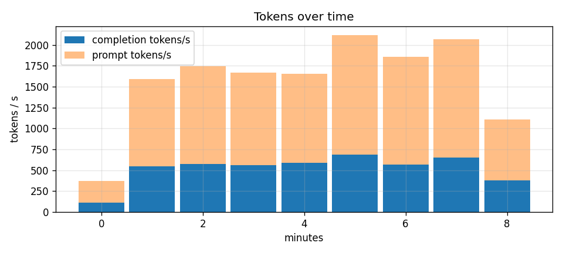

# tokenmeter

Per-tenant, per-model token accounting for LLM serving: $ per million tokens, MFU tracking and a cost dashboard.

Project 12 of 15 in [inference-infra-portfolio](https://github.com/NomanJafar/inference-infra-portfolio).

## What this builds

Per-tenant, per-model token accounting with $ per million tokens and MFU tracking on a dashboard.

## Why it matters

Inference is a unit-economics game. Whoever measures it wins.

## Status

Done. One measured run on a Kaggle T4 is written up below; the raw records are in `results/kaggle_run2/`.

## Results

Measured on 17 Oct 2026, Kaggle T4 (16 GB), vLLM 0.31.0, Qwen2.5-1.5B-Instruct in fp16 (weights 2.98 GiB, KV cache 340,064 tokens). Three tenants ran open-loop [tokenbench](https://github.com/NomanJafar/tokenbench) sweeps in parallel through the metering proxy for 480 s with unique prompts:

| tenant | arrival rate | prompt → max tokens | shape |
|---|---|---|---|
| chat | 3 req/s | 96 → 128 | many short turns |
| rag | 0.5 req/s | 1,500 → 48 | long context, short answer |
| bulk | 0.5 req/s | 64 → 384 | short prompt, long generation |

The proxy recorded 1,877 requests (0 errors, 0 estimated usage rows) with 570,382 prompt and 280,208 completion tokens. The report was built with `tokenmeter report --gpu-usd-per-hour 0.35 --params 1.54e9 --weight-gib 2.98 --step-ms 25.7`.

### Unit price

| | |
|---|---|
| GPU time billed | 0.1355 h × $0.35/h = **$0.0474** |
| $ / M completion tokens, fully loaded | **0.112** |
| $ / M completion tokens, marginal (busy time only) | 0.110 |
| $ / M prompt tokens (prompt weight 0.25) | 0.028 |
| same tokens at a $0.15 in / $0.60 out hosted tier | $0.254 (5.4x) |
| fully loaded price if the card were 30 % utilised | $2.76 / M |

The loaded and marginal prices are within 2 % of each other because the load generators kept the card busy for the whole window; the gap between them is the cost of idle time, which is why the 30 % scenario is the number that matters for a real deployment. Aggregate completion throughput was 584 tok/s, about 36 % of the 1,637 tok/s [servellm](https://github.com/NomanJafar/servellm) measured on the same card at 64 concurrent users, so even the "busy" window leaves a 2.8x cheaper price on the table for a fuller batch.

### Attribution

| tenant | requests | prompt tok | completion tok | share of raw tokens | weighted share (bill) | $ | TTFT p50 / p95 | out tok/s |
|---|---|---|---|---|---|---|---|---|
| chat | 1,423 | 196,552 | 182,144 | 44.5 % | **54.7 %** | 0.0259 | 100 / 863 ms | 377 |
| rag | 227 | 349,896 | 10,896 | 42.4 % | **23.3 %** | 0.0110 | 623 / 1,179 ms | 23 |
| bulk | 227 | 23,934 | 87,168 | 13.1 % | **22.0 %** | 0.0104 | 627 / 1,167 ms | 179 |

Weighting prompt tokens at a quarter of completion tokens moved the RAG tenant from 42 % of raw tokens to 23 % of the bill and made chat the largest payer. That is the attribution policy, not a measurement: prefill is parallel and cheap per token, decode is a full weight read per token, and the 1/4 ratio is the same ratio hosted APIs encode in their in/out prices. The RAG tenant's TTFT (623 ms p50 for 1,500-token prompts, versus 100 ms for chat) shows where its cost actually lands: it pays in latency, not in GPU-seconds.

### Utilisation

| | |
|---|---|
| MFU (584 tok/s × 2 × 1.54e9 FLOPs / 65 TFLOPS) | **2.8 %** |
| memory-bandwidth utilisation (2.98 GiB per 25.7 ms step / 320 GB/s) | **38.9 %** |

MFU under 3 % with bandwidth utilisation near 40 % is the signature of memory-bound decode: every step streams the full weights once and does very little arithmetic per byte. The step time is taken from the chat tenant's ITL p50 (25.7 ms), which is the proxy's best view of the engine's step; a true per-step measurement needs the engine's own metrics.



### What to read with care

- $0.35/h is an assumed on-demand T4 price. Kaggle's T4 is free; the number is there so the arithmetic is reproducible, and every $ figure scales linearly with it.
- Usage comes from the final SSE chunk (`stream_options.include_usage`), so the counts are the server's own tokeniser counts, not estimates. The proxy's fallback estimator was never used in this run.
- MFU and bandwidth utilisation use the T4's dense fp16 peaks (65 TFLOPS, 320 GB/s). Turing has no FP8 and the Triton attention backend is not the fastest path on this card, so the absolute numbers are lower than an A100/H100 deployment would show; the shape of the conclusion (decode is memory-bound, idle time dominates cost) does not change.
- Run 1 never produced numbers: the Kaggle dataset that was meant to carry the private wheel was attached empty. `results/kaggle_run1/README.md` records the post-mortem; run 2 embeds the wheel in the notebook instead.

## Layout

```
CONCEPTS.md     the theory behind the project, written before the code
src/tokenmeter/   implementation
tests/          CPU-only tests, runnable on a laptop
notebooks/      GPU notebooks (Kaggle / Colab) that run the experiments and write results/
results/        measured numbers and plots
```

## Running

```bash
python -m venv .venv && source .venv/bin/activate
pip install -e ".[dev]"
pytest
```

GPU experiments run from `notebooks/`; each notebook clones this repo, installs it and writes its outputs to `results/`.

## Hardware notes

Developed against free-tier GPUs (Kaggle and Colab T4, 16 GB). Where a T4 limits what can be measured (no FP8, Turing-era kernels), the README says so rather than papering over it.

## License

MIT
